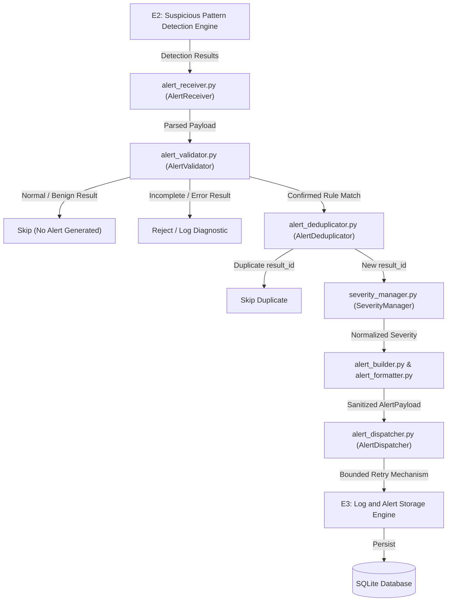

# E4: Alert Generation Engine Documentation

## 1. Purpose and Responsibilities

The **Alert Generation Engine (E4)** is the fourth core engine in the **Wireless Network Traffic Analysis and Alerting System**. Its primary responsibility is to accept suspicious activity detection results evaluated by **E2 (Suspicious Pattern Detection Engine)**, interpret the detection criteria, construct structured, schema-compliant security alerts adhering to the approved **Alert** database entity, and forward those alerts to **E3 (Log and Alert Storage Engine)** for persistent storage.

### Core Architectural Principles
- **No Independent Detection:** E4 does not perform pattern matching, packet inspection, or anomaly detection. All detection logic is strictly owned by E2.
- **No Direct Database Access:** E4 does not connect to SQLite or use SQLAlchemy directly. Persistence is strictly owned by E3.
- **Strictly Deterministic:** E4 does not use machine learning, deep learning, artificial intelligence models, or LLMs.
- **Fault-Isolated Execution:** Malformed, benign, or failed detection results are filtered out without terminating batch execution.
- **Zero Fabrication:** Unavailable network attributes (e.g., non-IP traffic lacking IP addresses) are preserved as `None` rather than fabricated.

---

## 2. E4 Workflow Architecture



---

## 3. Module Descriptions

| Module File | Component Name | Role and Description |
|---|---|---|
| `alert_receiver.py` | `AlertReceiver` | Ingests raw detection records (dictionaries or dataclasses) from E2, validates payload structure, ensures presence of mandatory `result_id` and `rule_match_status`, and extracts optional network context. |
| `alert_validator.py` | `AlertValidator` | Evaluates whether the incoming record indicates a confirmed suspicious rule match (`rule_match_status` is `True`, `"MATCHED"`, `"SUSPICIOUS"`). Filters out clean/normal traffic and incomplete results. |
| `severity_manager.py` | `SeverityManager` | Preserves and standardizes severity classifications (`LOW`, `MEDIUM`, `HIGH`, `CRITICAL`). Handles case-insensitivity and provides deterministic fallback without altering threat levels. |
| `alert_formatter.py` | `AlertFormatter` | Sanitizes text fields against HTML injection/XSS, strips unprintable control characters, and formats rich context dictionaries. |
| `alert_deduplicator.py` | `AlertDeduplicator` | Thread-safe, bounded memory LRU tracker that guarantees at most one alert is generated per unique `result_id`. |
| `alert_builder.py` | `AlertBuilder` | Assembles the final `AlertPayload` containing `alert_id`, `result_id`, `alert_details`, `alert_timestamp`, `severity`, and `alert_status` (`NEW`). |
| `alert_dispatcher.py` | `AlertDispatcher` | Communicates with E3 storage sink callable with bounded exponential retries and failure reporting. |
| `alert_generator.py` | `AlertGenerator` | Coordinates the end-to-end alert generation pipeline and compiles run summary statistics. |
| `e4_engine.py` | `E4AlertEngine` | Primary high-level engine coordinator exposing `process_result` and `process_batch` for backend coordination. |
| `severity_classifier.py` | Compatibility Wrapper | Re-exports `SeverityManager` for backwards compatibility. |
| `alert_engine.py` | Compatibility Wrapper | Re-exports `E4AlertEngine` under legacy naming conventions. |

---

## 4. Input and Output Contracts

### A. E2 → E4 Input Contract (`DetectionResultPayload`)
```json
{
  "result_id": "string (UUID, required)",
  "rule_match_status": "bool | string (True, 'MATCHED', 'SUSPICIOUS', required)",
  "log_id": "string (UUID, optional)",
  "rule_id": "string (optional)",
  "rule_name": "string (optional)",
  "suspicious_activity": "string (optional)",
  "severity": "string ('LOW' | 'MEDIUM' | 'HIGH' | 'CRITICAL', optional)",
  "observed_value": "float | int | string (optional)",
  "threshold_value": "float | int | string (optional)",
  "detection_evidence": "dict | string (optional)",
  "detection_time": "string (ISO 8601, optional)",
  "source_address": "string (IPv4/IPv6, optional)",
  "destination_address": "string (IPv4/IPv6, optional)",
  "source_mac": "string (MAC, optional)",
  "destination_mac": "string (MAC, optional)",
  "protocol": "string (optional)",
  "log_details": "dict (optional)"
}
```

### B. E4 → E3 Output Contract (`AlertPayload` matching `Alert` Entity)
```json
{
  "alert_id": "string (UUID4, primary key)",
  "result_id": "string (foreign key -> Detection_Result.result_id)",
  "alert_details": {
    "suspicious_activity": "string",
    "rule_id": "string | null",
    "rule_name": "string | null",
    "log_id": "string | null",
    "network_context": {
      "source_address": "string | null",
      "destination_address": "string | null",
      "source_mac": "string | null",
      "destination_mac": "string | null",
      "protocol": "string | null",
      "wireless": "dict | null"
    },
    "metrics": {
      "observed_value": "any | null",
      "threshold_value": "any | null"
    },
    "detection_evidence": "any | null",
    "summary_description": "string"
  },
  "alert_timestamp": "string (UTC ISO 8601)",
  "severity": "string ('LOW' | 'MEDIUM' | 'HIGH' | 'CRITICAL')",
  "alert_status": "string ('NEW')"
}
```

---

## 5. Security Measures

1. **Input Sanitization:** `AlertFormatter` escapes HTML entities (`&`, `<`, `>`, `"`, `'`) and strips non-printable ASCII control characters (`\x00-\x08`, `\x0b`, `\x0c`, `\x0e-\x1f`, `\x7f`) to prevent cross-site scripting (XSS) and log injection.
2. **Safe Deserialization:** Incoming payloads are parsed using native Python primitive validation; no unsafe `pickle` or arbitrary code execution is permitted.
3. **No Credential Logging:** Error messages and summaries avoid logging sensitive headers or payload bytes.
4. **No Direct SQL Execution:** E4 contains zero raw SQL strings, SQLite imports, or SQLAlchemy connection sessions, preventing SQL injection vulnerabilities.

---

## 6. Duplicate Prevention and Retry Strategy

- **Deduplication:** `AlertDeduplicator` maintains an LRU cache (default size: 10,000 entries) of processed `result_id` values. Re-evaluating an identical `result_id` results in immediate skip with diagnostic logging.
- **Bounded Dispatch Retries:** `AlertDispatcher` retries transient E3 failures up to `max_retries` (default: 3) using exponential backoff (`delay = initial_delay * (backoff_factor ^ attempt)`).
- **Idempotent Delivery:** Successfully dispatched `alert_id` records are recorded in `_dispatched_alert_ids` to guarantee that retries do not generate duplicate database inserts.

---

## 7. Testing Instructions

Run all E4 unit and integration tests:
```powershell
cd wireless-network-traffic-analysis/backend
python -m pytest tests/unit/test_alert_*.py tests/unit/test_severity_manager.py tests/integration/test_e4_engine.py -v
```

Run entire project test suite:
```powershell
python -m pytest -v
```

Run CLI runner demonstration:
```powershell
python backend/scripts/run_e4.py
```

